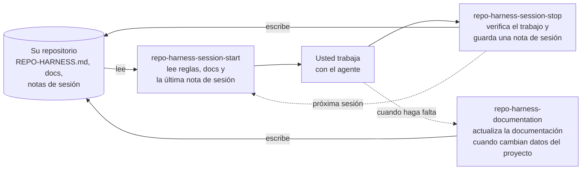

# repo-harness-builder
<!-- doc-role:repository-harness -->

<!-- README-I18N:START -->

[English](./README.md) | **Español**

<!-- README-I18N:END -->

`repo-harness` es un conjunto de instrucciones, reglas, documentación, habilidades y comandos para agentes de programación con IA como Claude Code, OpenCode y Pi. Guarda las guías y notas de sesión en el repositorio para poder revisarlas. `repo-harness-builder` crea, revisa y actualiza ese harness con seguridad.

## Qué genera
<!-- doc-role:outputs -->

- Un libro de reglas conciso en `REPO-HARNESS.md` y un README cuando falta.
- Documentación del proyecto sobre uso, estado actual, decisiones y cambios completados.
- Habilidades de sesión y documentación, con comandos para los entornos elegidos.
- Un verificador para mantener coherentes las copias de cada entorno y ajustes de archivos del repositorio.

El harness funciona por si solo. El modo integrado compone de forma independiente las capacidades disponibles de Gentle AI y Engram; CodeGraph es opcional. Consulte la [guia del constructor](docs/es/repo-harness/builder-guide.md) para conocer los limites de integracion y la lista completa de archivos generados.

## Instalación
<!-- doc-role:quick-start -->

1. Descargue el zip de su entorno de la [última versión](https://github.com/LCubero/repo-harness-builder/releases): `repo-harness-builder-<version>-claude-code.zip`, `repo-harness-builder-<version>-opencode.zip` o `repo-harness-builder-<version>-pi.zip`.
2. Extráigalo en la raíz del repositorio donde lo utilizará. Crea la carpeta de skills de su entorno indicada en la tabla (`skills` en plural). Manténgala dentro del repositorio; nunca la instale en una carpeta global o de usuario.

   | Entorno | Carpeta de la habilidad | Invocación |
   |---|---|---|
   | Claude Code | `.claude/skills/repo-harness-builder/` | `/repo-harness-builder` |
   | OpenCode | `.opencode/skills/repo-harness-builder/` | Pida al agente que use la skill `repo-harness-builder` |
   | Pi | `.pi/skills/repo-harness-builder/` | `/skill:repo-harness-builder` |

3. Abra ese repositorio en su entorno e invoque la skill una vez para preparar el harness. Responda sus preguntas y apruebe el plan antes de que haga cambios.

Requiere Python 3.10+ y su entorno ya instalado; si un destino ya existe, revíselo antes de extraer o sobrescribir.

Las versiones hasta `v3.1-rc.10` usaban un solo zip con `skill/` que debía copiarse manualmente.

## Uso diario
<!-- doc-role:skills -->

El harness guarda el contexto en los archivos de su repositorio, así cada sesión puede retomar donde terminó la anterior:

Las notas de sesión son respaldos locales en `.repo-harness/memory-bk/`. Cuando Engram está disponible, agrega memoria entre sesiones, pero los archivos del repositorio siguen siendo la fuente de verdad.

1. Inicie o reanude con `repo-harness-session-start`.
2. Trabaje normalmente: pida al agente que haga su tarea.
3. Cuando cambie información importante del proyecto, use `repo-harness-documentation` para mantener la documentación al día.
4. Al pausar o terminar, use `repo-harness-session-stop` para dejar contexto para la próxima sesión.

Pida al agente que use cada habilidad cuando la necesite. Consulte la [guía de uso](docs/es/repo-harness/usage.md) para más detalles.

## Más información
<!-- doc-role:license -->

Puede ejecutar el constructor de nuevo para una revisión o actualización opcional; consulte su guía.

- [Guía del constructor](docs/es/repo-harness/builder-guide.md): archivos generados, idiomas, actualizaciones seguras y desarrollo.
- [Guía de uso](docs/es/repo-harness/usage.md): trabajo con el harness instalado.
- [CONTRIBUTING.es.md](CONTRIBUTING.es.md): contribuciones a este proyecto.
- [Historial de cambios](CHANGELOG.es.md): cambios completados.
- [Licencia MIT](LICENSE).
