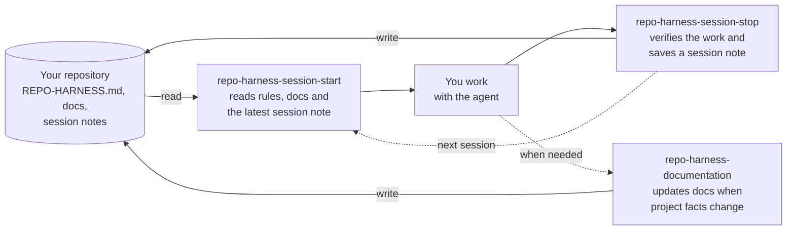

# repo-harness-builder
<!-- doc-role:repository-harness -->

<!-- README-I18N:START -->

**English** | [Español](./README.es.md)

<!-- README-I18N:END -->

`repo-harness` is a repository-scoped set of prompts, rules, documentation, skills, and commands for AI coding agents such as Claude Code, OpenCode, and Pi. It keeps project guidance and session notes in the repository, where maintainers can inspect them. `repo-harness-builder` creates, audits, and safely evolves that harness.

## What It Generates
<!-- doc-role:outputs -->

- A concise `REPO-HARNESS.md` rulebook and a README when one is missing.
- Project documentation for usage, current state, decisions, and completed changes.
- Session and documentation skills, with commands for your chosen runtimes.
- A checker for keeping runtime copies consistent, plus repository file settings.

The harness works on its own. Integrated mode composes available Gentle AI and Engram capabilities independently; CodeGraph is optional. See the [builder guide](docs/repo-harness/builder-guide.md) for integration boundaries and the complete list of generated files.

## Install
<!-- doc-role:quick-start -->

1. Download your runtime's zip from the [latest release](https://github.com/LCubero/repo-harness-builder/releases): `repo-harness-builder-<version>-claude-code.zip`, `repo-harness-builder-<version>-opencode.zip`, or `repo-harness-builder-<version>-pi.zip`.
2. Extract it at the root of the repository where you will use it. It creates your runtime's skills folder shown below (`skills` plural). Keep it inside the repository, never in a global or user-level configuration folder.

   | Runtime | Skill folder | Invocation |
   |---|---|---|
   | Claude Code | `.claude/skills/repo-harness-builder/` | `/repo-harness-builder` |
   | OpenCode | `.opencode/skills/repo-harness-builder/` | Ask the agent to use the `repo-harness-builder` skill |
   | Pi | `.pi/skills/repo-harness-builder/` | `/skill:repo-harness-builder` |

3. Open that repository in your runtime and invoke the skill once to set up the harness. Answer its questions and approve the plan before it makes changes.

Requires Python 3.10+ and your runtime already installed; if a destination already exists, inspect it before extracting or overwriting.

Releases up to `v3.1-rc.10` used a single zip containing `skill/` that had to be copied manually.

## Daily Use
<!-- doc-role:skills -->

The harness keeps context in your repository files, so each session can pick up where the last one stopped:

Session notes are local backups under `.repo-harness/memory-bk/`. When Engram is available it adds cross-session memory, but repository files remain the source of truth.

1. Start or resume with `repo-harness-session-start`.
2. Work normally: ask the agent to do your task.
3. When important project facts change, use `repo-harness-documentation` to keep project docs current.
4. When pausing or finishing, use `repo-harness-session-stop` to leave context for the next session.

Ask your agent to use each skill when needed. See the [usage guide](docs/repo-harness/usage.md) for details.

## Learn More
<!-- doc-role:license -->

You can run the builder again later for an optional audit or update; see the builder guide below.

- [Builder guide](docs/repo-harness/builder-guide.md): generated files, language choices, safe upgrades, and development.
- [Usage guide](docs/repo-harness/usage.md): working with the installed harness.
- [CONTRIBUTING.md](CONTRIBUTING.md): contributing to this project.
- [Changelog](CHANGELOG.md): completed changes.
- [MIT License](LICENSE).
